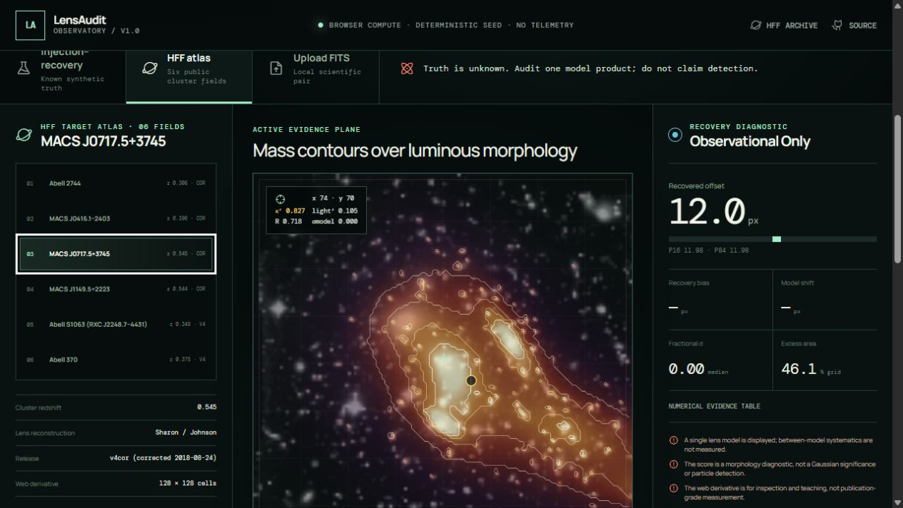
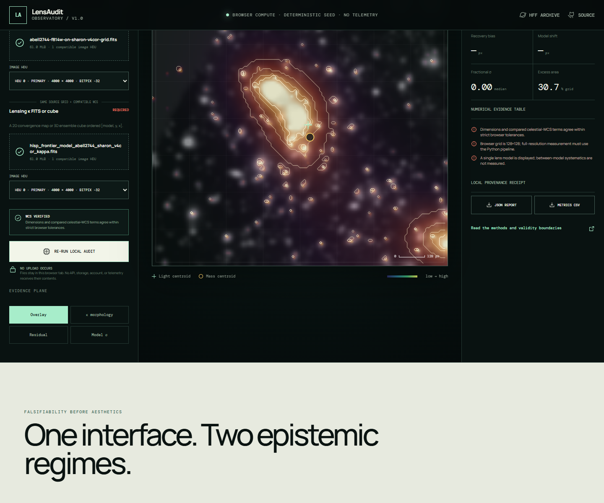

# Dark Matter Lensing Auditor

**A provenance-first spatial evidence workbench for comparing gravitational-lensing mass maps with telescope-image light proxies—without confusing a contour overlay with a dark-matter detection.**

[](https://github.com/Biswajit1999/dark-matter-lensing-auditor/actions/workflows/ci.yml)
[](https://biswajit1999.github.io/dark-matter-lensing-auditor/)
[](LICENSE)
[](https://www.astropy.org/)

[**Open the live Observatory →**](https://biswajit1999.github.io/dark-matter-lensing-auditor/)



## Not a template: a two-regime research instrument

The repository now contains two complementary interfaces over one scientific contract:

| Instrument | What it does | Epistemic status |
|---|---|---|
| **Observatory** (`web/`) | Runs deterministic injection–recovery experiments, compares two reconstruction-prior families, probes layered maps, and exports evidence in the browser | Synthetic truth is known and recovery bias is measurable |
| **FITS workbench** (`app.py` + `src/lensaudit`) | Fetches, hashes, aligns, and audits full-resolution HFF or user-supplied products | Observational truth is unknown; results are model audits |
| **Local FITS gate** (Observatory upload mode) | Inspects image HDUs, validates source grids and WCS, hashes both files, and audits a 2D κ map or 3D ensemble without network transfer | Requires light + lensing mass; image-only inference is disabled |

The visual distinction is intentional. The simulator may reveal injected truth; the six-field HFF atlas never does. This prevents a polished contour overlay from silently becoming a claim that dark matter was “seen.”

### Run the browser laboratory

```bash
cd web
npm ci
npm test
npm run dev
```

The browser app includes:

- seeded two-halo experiments with adjustable offset, ellipticity, subhalo ratio, model-position noise, and ensemble size;
- separate stylized parametric-prior and adaptive-grid-prior reconstruction families;
- injected versus recovered separation, 16th–84th percentile interval, recovery bias, and between-family centroid shift;
- mass, mass–light residual, and reconstruction-scatter evidence planes with an exact keyboard-accessible numerical probe;
- six target-specific 128 × 128 HFF web derivatives generated from verified 4000 × 4000 Sharon lens products and their corresponding HST mosaics;
- JSON/CSV evidence export, a visible numerical table, deep-linked observation mode, reduced-motion support, and responsive layouts;
- local 2D/3D FITS upload with HDU selection, strict registration checks, complete-file SHA-256 receipts, and a 512 MiB per-file safety limit;
- automated dependency audit, unit tests, production build, and GitHub Pages deployment.

Read the [experiment contract](docs/WEB_LAB.md), [local FITS upload contract](docs/UPLOAD_FITS.md), and [system architecture](docs/ARCHITECTURE.md) before extending the browser calculations.



## The idea, made scientifically defensible

An optical image contains photons from luminous matter. Dark matter does not appear as a dim patch waiting for an image contour. Its projected gravitational influence can be reconstructed from strong- or weak-lensing constraints, producing convergence (`κ`), shear (`γ`), deflection, or magnification products.

This project accepts:

1. a FITS intensity image that acts as a luminous-matter morphology proxy; and
2. a co-registered lensing convergence FITS map—or preferably an ensemble cube from multiple models or posterior realizations.

It then overlays mass contours on light, compares normalized morphologies, propagates ensemble disagreement, measures mass–light centroid offsets, and exports diagnostic maps. Image-only mode is available, but explicitly disables mass inference.

## Research gap

Full lens solvers such as `lenstronomy`, Lenstool, GRALE, GLAFIC, and SaWLens already address the difficult inversion problem. The Hubble Frontier Fields archive publishes lens products from several teams. The gap pursued here is narrower and complementary:

> Make cross-model uncertainty, mass–light mismatch, and invalid-input safeguards the default workflow for people exploring public lensing FITS products.

Published HFF comparisons show that statistical uncertainties from a single model can be smaller than the differences between modeling teams. An attractive single contour map can therefore imply more certainty than the model landscape supports.

## Real-data atlas: all six Hubble Frontier Fields clusters

The curated route is no longer a single synthetic or observational showcase. It contains six independently fetched, hashed, aligned, and aggregated official STScI Hubble Frontier Fields pairs:

| Target | Cluster redshift | Sharon release | HST light product |
|---|---:|---|---|
| Abell 2744 | 0.308 | `v4cor` | ACS/WFC F814W, 60 mas/pixel |
| MACS J0416.1−2403 | 0.396 | `v4cor` | ACS/WFC F814W, 60 mas/pixel |
| MACS J0717.5+3745 | 0.545 | `v4cor` | ACS/WFC F814W epoch 1, 60 mas/pixel |
| MACS J1149.5+2223 | 0.544 | `v4cor` | ACS/WFC F814W epoch 2, 60 mas/pixel |
| Abell S1063 | 0.348 | `v4` | ACS/WFC F814W epoch 1, 60 mas/pixel |
| Abell 370 | 0.375 | `v4` | ACS/WFC F814W epoch 1, 60 mas/pixel |

For Abell 2744 and the three MACS fields, the fetcher deliberately selects `v4cor`; STScI marks the older `v4orig` Sharon products as incorrectly scaled. Abell S1063 and Abell 370 use `v4`, the latest Sharon release listed for those fields, for which the archive exposes no `v4cor` variant. Every transfer is streamed to a partial path, byte-count checked, validated as FITS, SHA-256 hashed, and recorded in `provenance.json`. Each preparation step reprojects the target's light image onto that target's κ-map celestial WCS without interpolating the mass map.

```bash
python -m pip install -e ".[app,hff,test]"
lensaudit hff-fetch abell2744-sharon-v4cor --output data/hff
lensaudit hff-prepare data/hff/abell2744-sharon-v4cor --output data/hff/prepared
streamlit run app.py
```

Replace the dataset identifier with any entry shown by `lensaudit hff-fetch --help`. The full six-field source archive is approximately 960 MiB. These transfers are never hidden behind a web-app button, and the repository does not redistribute third-party telescope FITS products.

## Features

- 2D FITS intensity ingestion with readable-WCS reporting.
- 2D κ map or `[model, y, x]` ensemble-cube ingestion.
- Strict grid checks that stop rather than silently resize mismatched products.
- Robust background subtraction and smoothed light-proxy construction.
- Ensemble mean and scatter maps.
- Fitted normalized mass–light morphology residual.
- Conservative ensemble-aware discrepancy score with a documented systematic floor.
- Mass and light centroids with ensemble offset intervals.
- Percentile κ contours over image morphology.
- Kaiser–Squires E/B reconstruction utility for gridded shear null tests.
- Curated official HFF dataset contract with exact URLs, expected byte counts, release caveats, and citation routes.
- Atomic real-data download with SHA-256 provenance receipts.
- WCS-aware reprojection of light onto the unchanged lens-map grid.
- Map-centric Streamlit evidence console, Python API, and reproducible CLI.
- JSON, PNG, and FITS outputs.
- Synthetic cluster isolated in a validation lab rather than presented as observational evidence.
- Scientist-facing React/TypeScript Observatory with deterministic injection–recovery and an explicit observational boundary.
- Traceable compact HFF derivative carrying source filenames and SHA-256 hashes.
- Private in-browser FITS pairing with IMAGE-HDU discovery, WCS validity gates, κ-ensemble support, and exportable local provenance.
- Separate Python and web CI plus reproducible GitHub Pages deployment.

## Quick start

### Install the package and app

```bash
git clone https://github.com/Biswajit1999/dark-matter-lensing-auditor.git
cd dark-matter-lensing-auditor
python -m pip install -e ".[app,test]"
```

### Launch the research console

```bash
streamlit run app.py
```

The landing workflow presents the official HFF data contract. Synthetic data are confined to the validation tab.

### Run the reproducible CLI demo

```bash
lensaudit demo --output results/demo --seed 7
```

Outputs:

```text
results/demo/
├── audit.png
├── discrepancy-score.fits
├── kappa-ensemble.fits
├── science-image.fits
└── summary.json
```

### Analyze aligned FITS files

```bash
lensaudit analyze cluster-image.fits kappa-ensemble.fits \
  --output results/cluster \
  --sigma 2.0
```

The CLI intentionally rejects different array shapes. Reproject the products onto one celestial WCS using an astronomy-aware workflow before running the audit.

## Python API

```python
from lensaudit import audit_mass_light, read_fits
from lensaudit.plotting import make_audit_figure

image, image_header, image_wcs = read_fits("cluster-image.fits")
kappa, kappa_header, kappa_wcs = read_fits("kappa-ensemble.fits")

result = audit_mass_light(image, kappa, smoothing_sigma=2.0)
print(result.summary())
make_audit_figure(result, "audit.png")
```

For gridded weak shear:

```python
from lensaudit import kaiser_squires

kappa_e, kappa_b = kaiser_squires(gamma1, gamma2)
```

The B-mode map is a useful null diagnostic, but a small B mode does not prove the E-mode reconstruction is unbiased.

## What the score means

Image intensity and convergence have different physical units. The code therefore robustly normalizes each morphology and fits one scale factor between them. The residual is

```text
R = normalized mean κ − α × normalized light proxy.
```

The displayed discrepancy score divides `R` by the quadrature sum of ensemble scatter and a conservative floor. It is designed to reveal regions worth investigating and models that disagree.

It is **not**:

- a calibrated mass-to-light ratio;
- a Gaussian detection significance;
- a solution to the mass-sheet degeneracy;
- a particle-physics dark-matter detection;
- a replacement for a lens inversion;
- valid when the image and κ map are misregistered.

## Required scientific checks

Before interpreting an offset or excess:

- verify celestial WCS, pixel scale, orientation, and source redshift convention;
- use PSF-matched, background-treated, and consistently masked images;
- compare independent modeling teams as well as posterior samples within one team;
- inspect arc constraints and the region where the lens model is actually constrained;
- test smoothing scale and alternate stellar-mass/light tracers;
- propagate cluster-member subtraction and intracluster-light uncertainty;
- inspect shear B modes, boundaries, masks, and reduced-shear corrections for weak lensing;
- state the cosmology used to convert angular to physical offsets.

## Public data route

The [Hubble Frontier Fields lens-model archive](https://archive.stsci.edu/prepds/frontier/lensmodels/) provides public κ and γ maps, magnification products, deflection maps, and—in several releases—model realizations. The [Frontier Fields data archive](https://archive.stsci.edu/prepds/frontier/) provides co-located HST imaging and catalogs.

Always read the map-maker README, validity region, source-redshift normalization, and requested acknowledgements. The curated registry is intentionally small: an unreviewed file name is rejected instead of guessed.

## Evidence base

- [Schneider (1996)](https://arxiv.org/abs/astro-ph/9601039) introduced the aperture-mass framework for detecting projected mass concentrations through weak lensing.
- [Meneghetti et al. (2017)](https://arxiv.org/abs/1606.04548) compared lens-reconstruction methods on controlled synthetic clusters.
- [Priewe et al. (2017)](https://arxiv.org/abs/1605.07621) found that HFF model predictions can differ by more than quoted statistical uncertainties.
- [Raney et al. (2020)](https://arxiv.org/abs/2004.05952) quantified systematic versus statistical differences in HFF masses and magnifications.
- [Johnson et al. (2014)](https://arxiv.org/abs/1405.0222) describe public HFF mass/magnification products and mass–light comparisons.
- [STScI Hubble Frontier Fields lens models](https://archive.stsci.edu/prepds/frontier/lensmodels/) document the public FITS products and their modeling approaches.
- [`lenstronomy`](https://github.com/lenstronomy/lenstronomy) is a mature open-source strong-lensing solver; this project audits downstream products rather than duplicating that solver.

See [Research gap](docs/RESEARCH_GAP.md), [Methods](docs/METHODS.md), and [Data contract](docs/DATA_CONTRACT.md).

## Verification

```bash
pytest
lensaudit demo --output results/smoke-test
```

Tests cover deterministic synthetic generation, finite audit maps, single-model warnings, shape-mismatch rejection, FITS upload ingestion, zero-shear E/B behavior, curated-release safeguards, unknown-dataset rejection, and cryptographic download receipts.

### Weak-lensing validation extension

`python scripts/run_weak_lensing_validation.py` adds three known-truth checks:
Kaiser–Squires aperture-mass convergence, tangential-profile recovery versus
shape noise and source density, and a physics-aware regression of the
mass-sheet degeneracy. See
[`docs/WEAK_LENSING_VALIDATION.md`](docs/WEAK_LENSING_VALIDATION.md) for
equations, units, assumptions, and the observational-claim boundary.

## Roadmap to a research release

- Cross-team κ normalization and source-redshift harmonization.
- Stellar-mass rather than raw-light proxy support.
- Mask-aware Kaiser–Squires and aperture-mass significance maps.
- Bootstrap centroid uncertainties including image-background choices.
- Synthetic recovery challenge with blinded truth and preregistered metrics.
- Reproduction notebooks for a Frontier Fields cluster.

## Repository map

```text
app.py                    Streamlit evidence console
src/lensaudit/hff.py      curated STScI registry, fetch receipts, WCS preparation
src/lensaudit/core.py     mass–light audit and Kaiser–Squires utility
src/lensaudit/io.py       FITS ingestion
src/lensaudit/plotting.py publication-style evidence figure
src/lensaudit/cli.py      reproducible batch workflow
tests/                    physics and data-contract safeguards
docs/                     assumptions, gap, and input contract
```

## Citation and contribution

Use [CITATION.cff](CITATION.cff) for the software and separately cite the lens-model products and scientific method used. Contributions should include a validity statement, a synthetic recovery test, and an example that fails safely.

## License

MIT. Telescope data and third-party lens models retain their own terms, attribution, and publication requirements.
